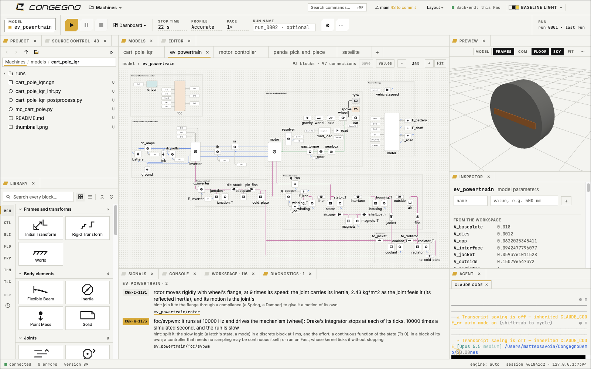
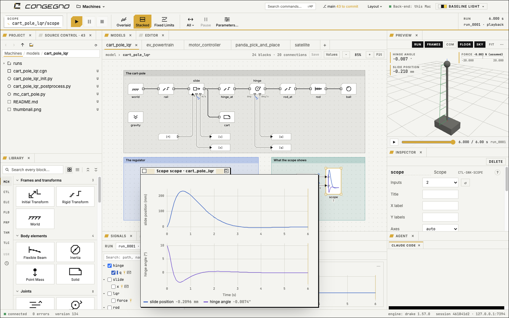
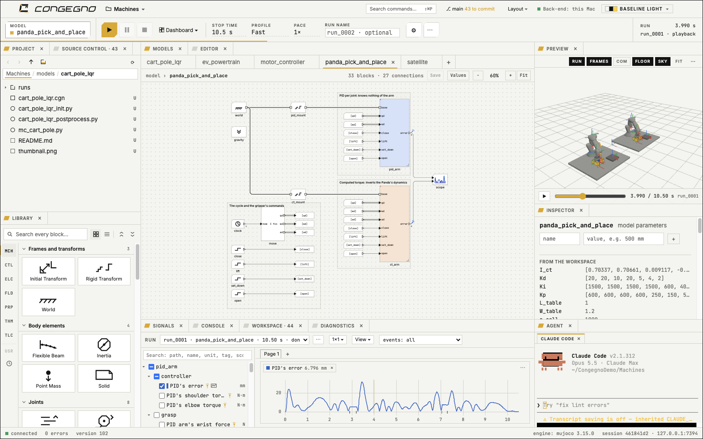

# Congegno

**Many natures, one environment.**

Congegno is a desktop application to draw and simulate machines together with their control. Block diagrams,
multibody mechanics, physical networks and state machines live in one model, in one workspace, and run together.

*Congegno* is Italian for "mechanism" (con-JEN-yo).



This repository holds Congegno's **downloads**, its **release notes** and its **issue reports**. Congegno is free to
try under the [Congegno Preview Licence](LICENSE.md). It is not open source.

## What it does

- **Block diagrams**: sources, sinks, math, continuous and discrete blocks, lookup tables, buses, subsystems,
  several sample rates in one model, and Python Function and C Function blocks. The control diagram is compiled to
  native code.
- **Multibody mechanics as blocks**: frames, rigid transforms, solids from simple shapes or CAD files, joints,
  forces, contact and flexible beams. You never declare a body: Congegno finds the bodies from how the frames are
  connected.
- **Multiphysics**: physical networks with conserving ports, from 1-D mechanics to electrical, thermal, gas and
  propulsion, compiled by OpenModelica; a whole Modelica model, or equations typed in, as a block.
- **State machines**: modes, sequences and fault handling drawn as states and transitions on a canvas of their own.
- **Two engines**: the *Accurate* profile runs on Drake, the *Fast* profile on MuJoCo.
- **Results you can look at**: a 3D view with playback and overlays, scopes, dashboards, Matplotlib figures, video
  export.
- **Scripting**: a Python console and an editor in the app; run a model from a script.
- **Agents**: run your own AI coding agent in a terminal inside the app, acting on the models you see.
- **Everything is a file**: a model is a plain text file you can read, compare and keep under Git.





The eight examples on the start page (also Help ▸ Examples…) are a good place to start: each card copies one into your project and runs its init script.

## Download

The current build is **[0.1.0-preview.2](../../releases/tag/v0.1.0-preview.2)**, a free preview. Expect rough edges, and tell us about them.

| System | Download |
|---|---|
| macOS, Apple Silicon | [`Congegno-0.1.0-preview.2-arm64.dmg`](https://github.com/msavox/congegno-releases/releases/download/v0.1.0-preview.2/Congegno-0.1.0-preview.2-arm64.dmg) |
| macOS, Intel | [`Congegno-0.1.0-preview.2-x64.dmg`](https://github.com/msavox/congegno-releases/releases/download/v0.1.0-preview.2/Congegno-0.1.0-preview.2-x64.dmg) |
| Linux x86_64 | [`Congegno-0.1.0-preview.2-linux-x86_64.AppImage`](https://github.com/msavox/congegno-releases/releases/download/v0.1.0-preview.2/Congegno-0.1.0-preview.2-linux-x86_64.AppImage) |
| Windows 10 and 11, 64-bit | [`Congegno-0.1.0-preview.2-windows-x64.exe`](https://github.com/msavox/congegno-releases/releases/download/v0.1.0-preview.2/Congegno-0.1.0-preview.2-windows-x64.exe) |

Each file has a `.sha256` beside it, and each is complete: its own Python, the engines, OpenModelica with the Modelica
Standard Library and a C compiler (on an Intel Mac and on Windows, inside the small Linux system that runs the
engines). You need no Xcode, Homebrew or Python of your own. Every release is in [Releases](../../releases).

## System requirements

- **macOS, Apple Silicon**: macOS 15 or later; about 2 GB of disk for the app.
- **macOS, Intel**: macOS 13 or later. Simulations run in a small Linux system that the app carries and starts by
  itself: the download is about 1.5 GB larger, and Linux takes more disk once prepared. The first launch of a new
  version takes a minute or two to prepare it, and each launch about twenty seconds to start it. By default it gets
  all the cores and half the memory, at least 4 GB; File ▸ Back-End Settings… changes that.
- **Linux**: x86_64, glibc 2.34 or later (Debian 12, Ubuntu 22.04, Fedora 35 and later), and FUSE (`fuse3`; most
  desktops have it). No root access is needed. The AppImage is one file of under 1 GB.
- **Windows**: Windows 10 (version 1809 or later) or 11, 64-bit, 8 GB of memory or more, and the **Windows Hypervisor
  Platform** turned on. As on an Intel Mac, simulations run in a small Linux system that Congegno starts by itself,
  under [QEMU](https://qemu.weilnetz.de/w64/), which Congegno does not include: it finds it, or installs it for you
  from its publisher on its first start.

## Install on macOS

The app is not notarized by Apple yet, so macOS refuses to open a copy that comes straight from a downloaded `.dmg`:
it says it cannot check the app for malicious software. On macOS 15 and later, right-click ▸ Open no longer gets
around this. The `.dmg` window shows two steps that do:

1. Open the `.dmg` and drag Congegno to Applications.
2. Open Terminal and paste the line the window shows:

   ```sh
   bash /Volumes/Congegno/install.sh
   ```

   The script checks that Congegno in Applications is the `.dmg`'s app, whole and with its signature intact, removes
   the download mark from `/Applications/Congegno.app` only, and opens it. It asks for no password and changes no
   setting of macOS. If you skipped step 1, it says so. The line is the same for every release.

Without Terminal: open Congegno, let macOS refuse it, then go to System Settings ▸ Privacy & Security and choose
**Open Anyway**.

With the GitHub CLI, one command downloads a release, checks its SHA-256 and installs it:

```sh
gh release download v0.1.0-preview.2 --repo msavox/congegno-releases --pattern install_release.sh && bash install_release.sh v0.1.0-preview.2
```

## Install on Linux

Make the AppImage executable and open it:

```sh
chmod +x Congegno-0.1.0-preview.2-linux-x86_64.AppImage
./Congegno-0.1.0-preview.2-linux-x86_64.AppImage
```

Where FUSE is missing, `./Congegno-0.1.0-preview.2-linux-x86_64.AppImage --appimage-extract-and-run` opens it.

To install it with a desktop entry, icons and the file types of `.cgn` and `.cgnproj`, download
`install_release_linux.sh` from the release, keep the AppImage's `.sha256` beside the AppImage, and run:

```sh
bash install_release_linux.sh ./Congegno-0.1.0-preview.2-linux-x86_64.AppImage
```

It checks the checksum, copies the AppImage to `~/Applications/Congegno.AppImage` and adds Congegno to your
applications.

## Install on Windows

The installer is not signed yet, so Windows asks once.

1. Turn on **Windows Hypervisor Platform**: Settings ▸ System ▸ Optional features ▸ More Windows features, tick it,
   OK, and restart Windows. Or, in PowerShell as administrator:

   ```powershell
   Enable-WindowsOptionalFeature -Online -FeatureName HypervisorPlatform
   ```

2. Run `Congegno-0.1.0-preview.2-windows-x64.exe`. SmartScreen says it protected your PC: choose **More info ▸ Run
   anyway**. No administrator is asked for: Congegno goes in your own programs folder.
3. Open Congegno. Without QEMU the splash screen says so: **Download and Install QEMU** downloads Stefan Weil's
   installer, checks it against its publisher's checksum, shows who signed it and runs it (Windows asks for
   permission for that step only). Or install QEMU yourself and Congegno finds it, or point it at QEMU's folder with
   **I Have QEMU In…**.
4. Congegno then prepares its Linux, a few minutes the first time, and opens the workspace. Your projects live on
   that Linux's disk: File ▸ Import from Windows brings files in, Export to Windows… in the Project panel's menu takes
   them out, and File ▸ Back Up Projects… saves them all in one `.zip`.

## First launch

Congegno first shows its terms, the Congegno Preview Licence: **Accept** to go on, or **Quit**. It asks once, and
again only when a new version of the terms comes. Then it opens the folder `~/Congegno` as its project (on Windows, a
folder of its Linux's disk), and its start page offers eight working examples to copy and run.

## Updates, and how long a preview runs

Once a day Congegno reads this repository's list of releases and tells you when a newer preview, or the stable
release, is out, with a link to its page; Help ▸ Check for Updates… asks now, and Help ▸ Check for Updates
Automatically turns it off. Nothing is downloaded or installed for you.

Each preview build runs for **90 days** from the day it was built, and says so two weeks ahead. After that it still
opens your models and your runs, but starts no new runs until you install a newer one. A preview taken off this page
tells you it was withdrawn.

## The licence, in short

Congegno is free to download, install and use to try it, evaluate it, learn and teach with it, and for personal
projects. It is not for production or commercial use yet: final terms will come. There is no warranty. What you make
with it is yours, and you may share it. Congegno collects no telemetry and needs no account, licence key or
activation; the only request it makes by itself is the daily look at this repository's releases, which you can turn
off. Each preview build runs for 90 days. It is not open source; it runs open-source engines and libraries (Drake, MuJoCo, OpenModelica and
others) under their own licences, listed in Help ▸ About Congegno ▸ Licences.

The full text is in [LICENSE.md](LICENSE.md), and it is the one that counts.

## Reporting a problem

In Congegno, Help ▸ Report a Problem… opens a new [issue](../../issues/new/choose) here. Say what you did, what you
expected and what happened, and paste what Help ▸ About Congegno ▸ This Installation copies (version, system,
engines). A small model that shows the problem helps most; the session log is `~/.congegno/logs/session.log`. Please
attach only what you are free to share.

© 2026 Matteo Savoia.
