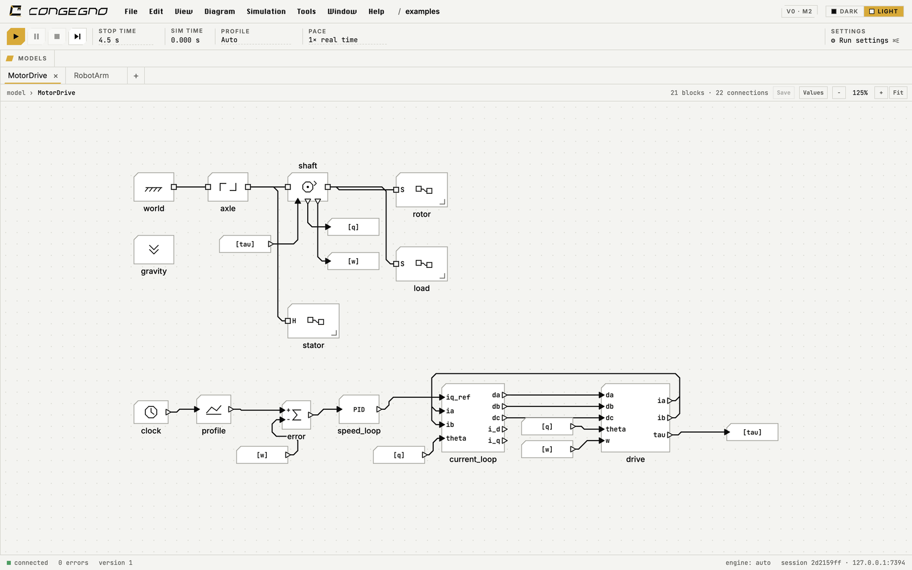
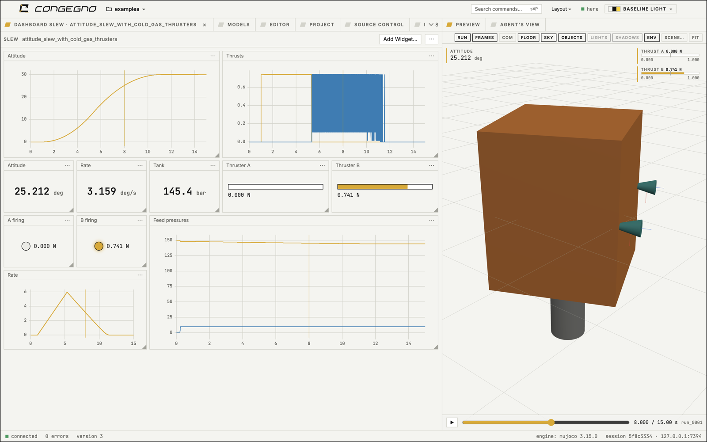
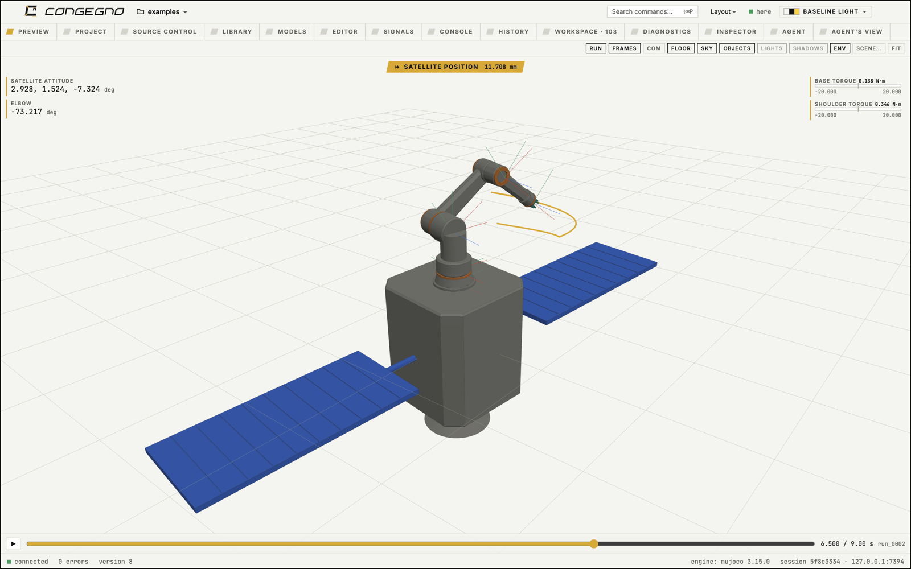

# Congegno

**Build the machine. Wire the control. Press Run.**

Congegno is a desktop IDE for simulating machines and their control, all drawn as blocks. Mechanisms, controllers,
circuits, gas networks and heat run together: the mechanism on Drake or MuJoCo, every physical network compiled by
OpenModelica, the control diagram compiled to native code.

This repository holds Congegno's **downloads**, its **release notes** and its **issue reports**. The source code is
not public.

Site: https://congegno.marunja.com



## Download

Get the latest build from [Releases](../../releases). Congegno is in pre-release: expect rough edges, and tell us
about them.

| System | File | Requirements |
|---|---|---|
| macOS, Apple Silicon | `Congegno-<version>-arm64.dmg` | macOS 15 or later |
| macOS, Intel | `Congegno-<version>-x64.dmg` | macOS 13 or later; runs its back-end in a small Linux VM it carries (about 5 GB on disk) |
| Linux x86_64 | `Congegno-<version>-linux-x86_64.AppImage` | glibc 2.34+ (Debian 12+, Ubuntu 22.04+, Fedora 35+), FUSE |

Windows is planned.

Each file has a `.sha256` beside it.

### Install on macOS

1. Open the `.dmg` and drag Congegno to Applications.
2. The app is not notarized yet, so open Terminal and run `bash /Volumes/Congegno/install.sh`. It checks the app
   came whole from the `.dmg`, removes the download mark and opens it. No password, no system setting changed.
   Or: open Congegno, let macOS refuse it, then System Settings ▸ Privacy & Security ▸ Open Anyway.

With the GitHub CLI, one command downloads, checks and installs:
```
gh release download --repo msavox/congegno-releases --pattern install_release.sh && bash install_release.sh
```

On an Intel Mac the first launch unpacks the back-end's Linux and starts it (about two and a half minutes); later
launches take seconds.

### Install on Linux

```
chmod +x Congegno-<version>-linux-x86_64.AppImage && ./Congegno-<version>-linux-x86_64.AppImage
```
Or with its desktop entry and file types:
```
gh release download --repo msavox/congegno-releases --pattern install_release_linux.sh && bash install_release_linux.sh
```

## What it does

- **Multibody mechanics**: joints, bodies from shapes or CAD files, contact, flexible beams, deployment hinges,
  releasable welds; observed from any frame.
- **Control**: a Simulink-like block library, Python and C function blocks, zero crossings located exactly,
  discrete and continuous rates, compiled to native code.
- **Physical networks**: electrical, fluid, thermal, compiled by OpenModelica, coupled to the mechanism.
- **SI in every number**: units are settings of the views, never hidden conversions.
- **A workspace like MATLAB's**: scripts, a console, live Matplotlib figures, `cogita()` to run a model from Python.
- **Results you can look at**: scopes, dashboards, a 3D view with overlays, video export.
- **Agents**: an AI agent can drive Congegno through the same commands as the GUI.




## Reporting a problem

Open an [issue](../../issues/new/choose) with the version (Help ▸ About), your system, what you did and what
happened. A small model that shows the problem helps most. Please do not attach anything you are not free to share.

## Licence

Congegno is proprietary software, free to use under the terms in [LICENSE.md](LICENSE.md). It uses software of
others under their own licences, listed in the app's About ▸ Licences.

© 2026 Matteo Savoia.
